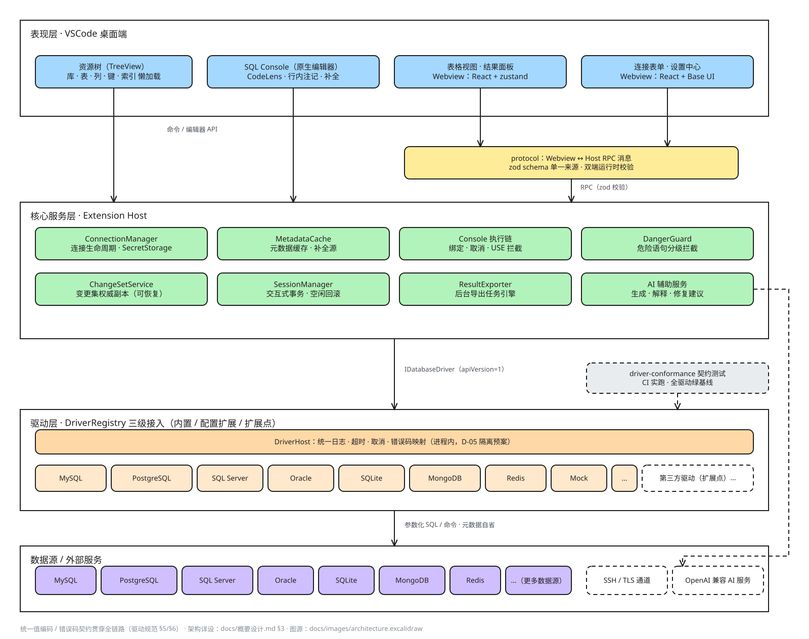

# DB Kit — Database Explorer (VSCode Extension)

> 🌐 简体中文: [README.md](README.md)

> [!TIP]
> Listed on the VSCode Marketplace: search **DB Kit** in the Extensions panel to install, or open the [marketplace listing](https://marketplace.visualstudio.com/items?itemName=db-explorer-dev.db-kit) / `ext install db-explorer-dev.db-kit`
>
> 🌐 **Product website**: [dbkit.easyremember.cn](https://dbkit.easyremember.cn/) (source in [website/](website/), hosted on Tencent Cloud EdgeOne)

UI text follows the VSCode display language (English / Chinese). Screenshots in the docs were taken from the Chinese UI.

DB Kit provides a unified, pluggable entry point for database access inside VSCode, covering the full chain of "browse structure → query data → edit data → write SQL". It supports seven kinds of external data sources — MySQL, PostgreSQL, SQL Server, Oracle, SQLite, MongoDB, Redis — and ships as a single-file VSIX with zero native dependencies.

## Architecture Overview



The presentation layer (native views + Webview) calls the Extension Host service layer through the zod RPC contract in `protocol`; the service layer accesses pluggable drivers through a unified `DriverHost` intermediary (logging / timeout / cancellation) — drivers plug in at three levels ("built-in / configured extensions / extension points"), and beyond the built-in roster they can keep growing (the "…" in the diagram), with contracts fully guarded by the `driver-conformance` suite. Diagram source: [architecture.excalidraw](docs/images/architecture.excalidraw) (editable Excalidraw); for the detailed layering design see [Design Overview §3](docs/概要设计.md) (Chinese).

## Feature Matrix

| Capability | MySQL | PostgreSQL | SQL Server | Oracle | SQLite | MongoDB | Redis |
|---|---|---|---|---|---|---|---|
| Resource tree | databases/tables/views/columns/keys/indexes | schemas/tables/views/columns/keys/indexes | schemas/tables/views/columns/keys/indexes | schemas/tables/views/columns/keys/indexes | single database/tables/columns | databases/collections/field catalog | key-type catalog/keys |
| Data browsing (filter/sort/search push down + pagination) | ✓ | ✓ | ✓ | ✓ | ✓ | ✓ | ✓ typed display |
| Table editing (change set + optimistic locking + transactional commit) | ✓ | ✓ | ✓ | ✓ | ✓ | ✓ document edit | — (read-only) |
| SQL Console (completion / history / dangerous-statement blocking) | ✓ | ✓ | ✓ | ✓ | ✓ | mongosh command console | command console |
| Interactive transactions (idle-timeout rollback) | ✓ | ✓ | ✓ | ✓ | ✓ | — | — |
| Table schema editor (create/alter tables, columns) | ✓ | ✓ | ✓ | ✓ | ✓ | — | — |
| Database-level DDL (create/edit/drop database) | ✓ | ✓ create/drop schema | ✓ create/drop schema | ✓ create/drop schema | — (single database) | ✓ create/drop database | — (fixed database count) |
| SSL / SSH tunnel (TOFU fingerprint) | ✓ | ✓ | ✓ | ✓ tunnel | — | ✓ | ✓ / TLS |
| Export (CSV/JSON/XLSX/NDJSON/Markdown/SQL INSERT, cancellable background tasks) | ✓ | ✓ | ✓ | ✓ | ✓ | ✓ | ✓ |
| Conformance tests (run for real in CI) | ✓ | ✓ | ✓ | ✓ | ✓ | ✓ | ✓ |

More capabilities: AI assistant (BYOK: natural-language → SQL, SQL explanation, error fix suggestions, natural-language table filter, query plan explanation, "Try Again" regeneration; sampling parameters and usage stats in the Settings hub), cell viewer for long text / JSON / binary, ER diagram viewer with SVG/PNG export (table-centered neighbor expansion and referential-action labels on edges), result-set charts (one-click line / bar from Console results with automatic downsampling), schema compare (cross-database structure diff within a connection), View DDL, Generate Code from Schema (TS/Java/Go/Prisma), copy as multiple formats, Format SQL, saved queries with the in-tree query folder, EXPLAIN tree indentation, inline execution-result annotations, per-statement CodeLens execution, and the operation log (`dbExplorer.showLog`).

## Install

**VSIX (recommended, GitHub Release)**: download the latest `db-kit-<version>.vsix` from [Releases](https://github.com/Fengjing95/vsc-plugin-db/releases) → "…" at the top right of the VSCode Extensions view → **Install from VSIX…**; or from the command line:

```bash
code --install-extension db-kit-<version>.vsix
```

**Run from source (development)**: see the [Development](#development) section below.

## Quick Start

1. The **Database** icon in the activity bar → **＋ New Connection** in the view title bar (any of MySQL / PostgreSQL / SQL Server / Oracle / SQLite / MongoDB / Redis);
2. Expand the connection → database → `Tables` → click a table name to open the table view (column-header sorting, the free-form WHERE/ORDER BY condition bar, global search, column show/hide and pagination are all pushed down server-side);
3. Edit: double-click / `Enter` / `F2` to edit a cell → **Commit Changes (N)** in the toolbar → parameterized SQL preview → single-transaction commit, with conflicts pinpointed to the offending rows; right-click to switch between NULL and empty string;
4. Write SQL: **New Query** in the tree query folder or any `.sql` file → `Ctrl+Enter` to run (`Ctrl+Shift+Enter` for all), with a result panel of multi-result-set tabs + EXPLAIN tree indentation; UPDATE/DELETE without WHERE and dangerous operations against production databases are guarded by tiered confirmation;
5. Export: **Export** in the table toolbar → pick the format and scope → runs in the background (progress in the notification center, cancellable, tasks run concurrently).

## Known Limitations

- The UI language follows the VSCode display language (Chinese is the source language; English is the initial auxiliary translation); community surfaces such as issue templates are Chinese-only for now
- VSCode for the Web (github.dev) is not supported; desktop (`^1.85`) only
- The SQLite driver is limited to small-to-medium databases (≤ 100MB recommended; whole database in memory + atomic flush per write batch); synchronous execution cannot be canceled
- MongoDB editing uses field-level `$set` optimistic locking, applies one by one and stops at the first failure (no transaction semantics); structural mongosh commands (create index / alter collection etc.) are not supported
- Redis offers read-only browsing + a command console (no rollback-able transactions; editing not enabled)
- A standalone perf benchmark is not in place (covered by the conformance suite + the four quality gates)
- No telemetry; passwords live only in VSCode SecretStorage — never written to disk, never logged

For the full picture see [Design Overview §14 open issues](docs/概要设计.md) (Chinese) and [CHANGELOG.md](CHANGELOG.md).

## Documentation (docs/)

| Document | Description |
|---|---|
| [AGENTS.md](AGENTS.md) | **Must-read for agents/new members**: engineering constraints (quality gates / protocol / security) and the pitfall catalog with fixes |
| [概要设计 (Design Overview, Chinese)](docs/概要设计.md) | Product boundary, architecture, module-level design, ADR decision records (D-01~D-25) |
| [驱动开发规范 (Driver Development Guide, Chinese)](docs/驱动开发规范.md) | Full `IDatabaseDriver` contract, error codes, value encoding, loading mechanism |
| [交互设计稿 (Interaction Design Spec, Chinese)](docs/交互设计稿.md) | Wireframes, state machines, keyboard and copy rules for every surface |
| [技术选型 (Technology Selection, Chinese)](docs/技术选型.md) | T-01~T-14 candidate comparison and decisions |
| [评审记录 (Review Notes, Chinese)](docs/评审记录-2026-09-29.md) | Design review conclusions and the disposition of 16 revisions |

## Development

```bash
pnpm install        # install dependencies
pnpm build          # build webview-ui + extension (artifacts include the webview copy and materialized external deps)
pnpm test           # vitest (driver conformance and DoD perf included; redis/pg/mongo/mysql conformance is env-gated and auto-skips without a local instance)
pnpm lint           # ESLint
pnpm typecheck      # repo-wide TS type check

# Debug run: open the repo root in VSCode and press F5
# (starts the Extension Development Host; the Database icon appears in the activity bar)

# Package the VSIX (release recipe: --no-dependencies + external closure bundled, see esbuild.mjs)
pnpm --filter db-kit exec vsce package --no-dependencies
```

### Project Structure

```
packages/
├── core/                 # driver interface contracts, unified model, DriverRegistry, DriverHost, danger assessment / statement splitting
├── protocol/             # Webview ↔ Host RPC message definitions (zod single source)
├── extension/            # VSCode extension body (tree / commands / connection management / form & table Webview hosts / export / logging)
├── webview-ui/           # React + Vite + Tailwind v4 + shadcn/ui (table / form / Console / schema / database design pages)
├── driver-mock/          # built-in baseline driver (in-memory: 50k-row big database + 1000×20 wide table; green conformance baseline, not exposed in the connection form)
├── driver-mysql/         # MySQL driver (mysql2)
├── driver-postgres/      # PostgreSQL driver (pg, D-15 schemas in the tree)
├── driver-redis/         # Redis driver (node-redis, SCAN cursor pagination + command console)
├── driver-sqlite/        # SQLite driver (sql.js WASM single engine, D-16)
├── driver-mongo/         # MongoDB driver (official mongodb, D-17/D-18)
└── driver-conformance/   # driver conformance test suite (connection/metadata/pagination/pushdown/changeset/
                           #  cursor/scan/value encoding/cancellation/interactive transactions/DDL/database-level DDL)
```

### Key Decisions (excerpts)

- Drivers plug in at three levels (built-in / configured extensions / extension points); adding a driver takes zero core changes
- The authoritative change set copy lives in the Extension Host, so a crashed Webview can recover
- All driver calls go through the `DriverHost` intermediary (uniform timeout / cancellation / logging); the process-isolation fallback is ready (D-05: repeated reviews kept it in-process)
- Filtering/sorting must push down to the SQL layer (parameterized); full-table fetch for in-memory filtering is forbidden; full-table `COUNT(*)` is not executed by default
- Passwords live only in SecretStorage; error codes are unified (`DriverErrorCode`) and the UI matches codes without parsing text
- See [Design Overview chapter 11 ADR](docs/概要设计.md) (Chinese) for details (D-01~D-25)

## License

[Apache-2.0](LICENSE)
